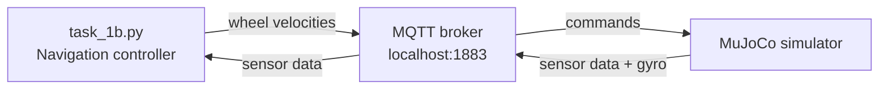

# PacBot Task 1B

### Autonomous maze navigation for the eYRC 2026-27 PacBot simulator

PacBot is a small autonomous robot controller that uses sensor feedback, wall following, and MQTT messages to navigate a MuJoCo maze. This repository contains the controller, simulator launcher, Windows/WSL helpers, and the files needed to reproduce a local run.

> **Current status:** The controller has completed a local run with `MAZE SOLVED`. Results can vary with simulator timing, machine configuration, and controller tuning.


## What happens when you run it?



The system has three cooperating processes:

| Process | Role |
| --- | --- |
| **Mosquitto** | Routes messages between the controller and simulator. |
| **MuJoCo** | Simulates the PacBot, maze, sensors, and physics. |
| **`task_1b.py`** | Reads sensors and publishes wheel commands. |

The controller subscribes to `pacbot/sensors` and publishes to `pacbot/wheel_vel` on `localhost:1883`.

## Highlights

- Distance-sensor filtering for steadier readings
- Gyroscope-based heading tracking
- PID steering correction for wall following
- Left-hand-rule maze navigation
- State-based corridor entry and turning
- Manual keyboard driving and sensor debugging tools
- Evaluation-mode simulator launch for submission runs

## Repository map

```text
PacBot-Task1B/
├── task_1b.py                 # Autonomous navigation controller
├── task_1b_boilerplate.py     # Starter/reference controller
├── task_1b_launch             # MuJoCo simulator executable
├── START_TASK1B.bat           # One-click Windows + WSL launcher
├── run_sim.sh                 # Simulator environment and launcher
├── run_1_broker.bat           # Start Mosquitto only
├── run_2_simulator.bat        # Start simulator only
├── run_3_navigation.bat       # Start controller only
├── teleop_keys.py             # Keyboard controller
├── run_manual_keys.bat        # Keyboard-controller launcher
├── debug_sim.sh               # Quick simulator diagnostics
├── test_wsl.bat               # WSL test helper
├── turbo_sim.c / turbo_sim.so # Optional simulator performance shim
├── requirements.txt            # Python dependencies
├── lib/                        # Bundled Linux shared libraries
└── meshes/                     # Robot mesh assets
```

## Quick start on Windows + WSL2

### Prerequisites

- Windows with WSL2
- An Ubuntu distribution named `Ubuntu-22.04`
- Python 3 and `pip`
- Mosquitto
- A working WSLg graphical display for MuJoCo

Install the system packages from Ubuntu:

```bash
sudo apt update
sudo apt install -y python3 python3-pip mosquitto gcc libgl1
```

Install the Python dependency:

```bash
python3 -m pip install -r requirements.txt
```

If Ubuntu reports an externally managed Python environment, use a virtual environment:

```bash
python3 -m venv .venv
source .venv/bin/activate
python -m pip install -r requirements.txt
```

### One-click local run

1. Open `START_TASK1B.bat` in Windows Explorer.
2. Leave the broker, simulator, and navigation windows running.
3. Wait for the MuJoCo window to appear. Use Alt+Tab if it opens behind another window.
4. Do not manually drive the robot while the autonomous controller is running.

The launcher starts:

1. Mosquitto on port `1883`
2. MuJoCo with `--evaluate`, so the evaluator records the run and writes its result
3. `python3 task_1b.py`

The batch files contain machine-specific paths. Update the `/mnt/c/.../pacbot_ws` path and WSL distribution name if your project is stored elsewhere.

## Official-style manual run

Use this when you want the simulator and controller in separate terminals. Start the broker first and keep each terminal open.

### Terminal 1: MQTT broker

```bash
mosquitto -v
```

### Terminal 2: simulator in evaluation mode

```bash
cd /path/to/PacBot-Task1B
export DISPLAY=:0
export WAYLAND_DISPLAY=wayland-0
export XDG_RUNTIME_DIR=/mnt/wslg/runtime-dir
LD_PRELOAD=./turbo_sim.so LD_LIBRARY_PATH=./lib ./task_1b_launch --evaluate
```

The `--evaluate` flag is required for a submission run. It enables run logging and result-file generation. Leave this terminal running.

If the performance shim causes a problem, launch without it:

```bash
LD_LIBRARY_PATH=./lib ./task_1b_launch --evaluate
```

### Terminal 3: navigation controller

```bash
cd /path/to/PacBot-Task1B
python3 task_1b.py
```

The controller should pull away from the entry point and begin following the wall. Do not touch either the simulator or controller terminal until the run stops.

## How the controller navigates

The controller combines filtered distance readings with gyroscope heading data. Its main states are:

| State | Purpose |
| --- | --- |
| `FOLLOW` | Follow the corridor and monitor front/side distances. |
| `ADVANCE_LEFT` | Move toward a detected opening before turning. |
| `TURN` | Rotate toward the target heading. |
| `ENTER` | Enter the selected corridor and resume wall following. |

The controller uses a left-hand rule, PID steering correction, heading correction, and threshold-based opening detection.

## Manual driving and diagnostics

To drive the robot manually, start the broker and simulator first, then run:

```bash
python3 teleop_keys.py
```

| Key | Action |
| --- | --- |
| `W` / Up | Forward |
| `S` / Down | Reverse |
| `A` / Left | Turn left |
| `D` / Right | Turn right |
| `Space` | Stop |
| `Q` | Quit |

Run only one controller at a time. Stop the current controller with `Ctrl+C` before switching between autonomous and manual control.

To inspect live sensor messages:

```bash
mosquitto_sub -h localhost -p 1883 -t pacbot/sensors -v
```

## Troubleshooting

### The controller cannot connect

Check that Mosquitto is running and that port `1883` is available:

```bash
sudo service mosquitto status
```

The controller and simulator must both use `localhost:1883`.

### The MuJoCo window does not appear

- Check the simulator terminal for an error.
- Confirm that WSLg is available and `DISPLAY` is set.
- Confirm that `lib/` and `meshes/` are present.
- Try the simulator without `LD_PRELOAD=./turbo_sim.so`.

### The simulator executable is denied

```bash
chmod +x task_1b_launch run_sim.sh debug_sim.sh
```

### The robot does not solve the maze

- Confirm that sensor messages are arriving.
- Check that only one navigation controller is running.
- Review the controller state transitions and sensor thresholds.
- Compare runs with and without the optional performance shim.

## Notes for contributors

- Keep personal paths, credentials, logs, and Python cache files out of Git.
- The bundled executable and libraries are Linux/WSL assets; they are not Windows-native binaries.
- Follow the official eYRC rules for simulator usage, evaluation, and redistribution.
- Record evaluation results separately from local development notes.

## License and competition notice

This repository documents a personal implementation and local development setup for PacBot Task 1B. It is not a replacement for the official eYRC instructions. Verify current competition requirements before submitting a run.

Repository: [FarazSualeh/PacBot-Task1B](https://github.com/FarazSualeh/PacBot-Task1B)
